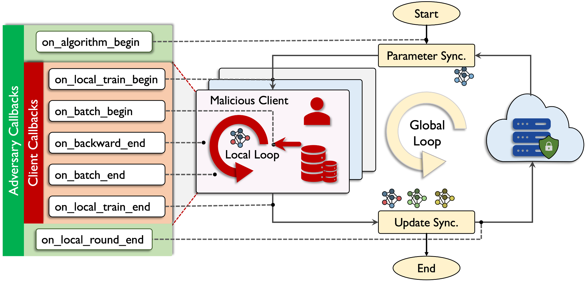
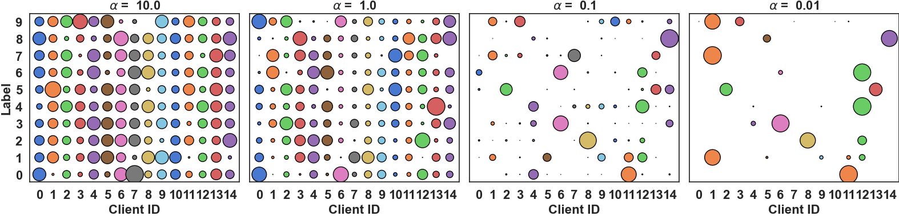
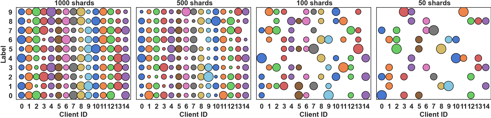

<div align="center">

[](LICENSE)
[](https://www.python.org/)
[](https://pytorch.org/get-started/pytorch-2.7/)
[](https://docs.ray.io/en/releases-2.39.0/)
[](https://github.com/king-buming/BladesALL)

# BladesALL

**A unified, editable framework for Byzantine attacks, robust aggregation, and federated learning — built on [Blades](https://github.com/lishenghui/blades) and [fedlib](https://github.com/fedlib/fedlib).**

Featuring the **SPEAR** family of adaptive model-poisoning attacks.



</div>

> **中文说明**：BladesALL 把本地定制的 Blades 攻击实现与 fedlib 联邦学习框架合并为一个项目。分发名为 **BladesALL**，Python 包名统一为 **`blades`**；攻击（含 SPEAR、SPEAR-SL 系列）、防御聚合器、数据集、模型与训练代码全部包含在本仓库中，无需另装 `fedlib`。

## Overview

**BladesALL** integrates the attack implementations of [Blades](https://arxiv.org/abs/2206.05359) with the Ray-based federated learning core of [fedlib](https://github.com/fedlib/fedlib) into a single editable package. It is designed for studying **Byzantine-robust federated learning**: run a federated optimizer (FedAvg, FedProx, DP-FedAvg) over Ray, inject malicious clients through pluggable adversaries, and evaluate defenses through pluggable aggregation rules — all configured from a single YAML file.

Key features:

- **Unified package**: one `blades` package for attacks, defenses, datasets, models, and training; no separate `fedlib` installation.
- **SPEAR attack family**: adaptive model-poisoning attacks with spectral evasion and sign alignment (SPEAR, SPEAR-SL, SPEAR-SL2).
- **YAML-driven experiments**: everything (dataset, model, algorithm, adversary, aggregator) is declarative and swappable.
- **Ray-powered scaling**: same code runs on a laptop (CPU/GPU) or a Ray cluster.

## Installation

Requires **Python 3.10–3.12**. A clean virtual environment is recommended to avoid conflicts with an older `blades` package.

```bash
git clone https://github.com/king-buming/BladesALL
cd BladesALL

python3.11 -m venv .venv
source .venv/bin/activate        # Windows: .\.venv\Scripts\Activate.ps1
python -m pip install --upgrade pip
python -m pip install -e ".[dev]"
```

The `-e` flag installs the project in **editable mode** — local code changes take effect without reinstalling. The dependency set keeps the proven combination of PyTorch 2.7.1, torchvision 0.22.1, and Ray 2.39.0.

> **中文说明**：Windows 下用 `py -3.11 -m venv .venv` 创建环境，激活脚本为 `.\.venv\Scripts\Activate.ps1`。安装后可用 `python -c "import blades; print(blades.__file__)"` 确认导入的是本项目的 `blades/__init__.py`。仅跑实验时可省略 `[dev]`。

## Quick Start

Run a tiny CPU-only training on synthetic data (no dataset download needed):

```bash
python -m examples.smoke_train
```

Launch a YAML experiment and inspect the CLI:

```bash
python -m blades --help
python -m blades file blades/tuned_examples/fedsgd_cnn_fashion_mnist.yaml
```

After installation, the `blades` / `bladesall` entry points are also available:

```bash
blades file blades/tuned_examples/fedsgd_cnn_fashion_mnist.yaml
```

**BladesALL** internally uses `ray.tune`, so experiment outputs are written to `~/ray_results` by default. The `run` field accepts `FEDAVG` (with attacks), `FEDAVG_BASE` (plain FedAvg), `FEDAVG_DP`, and `FEDPROX`; adversary and aggregator classes are referenced by full path, e.g. `blades.adversaries.SPEARAdversary`.

> **中文说明**：先跑 `python -m examples.smoke_train` 验证环境通畅（合成数据、CPU、无需下载）。真实 YAML 实验首次运行会下载数据集（固定路径 `~/fldata`），并需要按本机 GPU/CPU 配额调整配置中的资源与训练轮数。

## Project Layout

| Component | Location |
| --- | --- |
| Adversaries (incl. SPEAR, SPEAR-SL) | [`blades/adversaries/`](blades/adversaries/) |
| Defenses & aggregators | [`blades/aggregators/`](blades/aggregators/) |
| Datasets & partitioners | [`blades/datasets/`](blades/datasets/) |
| Models | [`blades/models/`](blades/models/) |
| Trainers, server & callbacks | [`blades/trainers/`](blades/trainers/) |
| FedAvg / DP-FedAvg implementations | [`blades/trainers/fedavg/`](blades/trainers/fedavg/) |
| Algorithm registry & compatible imports | [`blades/algorithms/`](blades/algorithms/) |
| Clients, tasks & execution core | [`blades/clients/`](blades/clients/), [`blades/core/`](blades/core/) |
| Experiment configs | [`blades/tuned_examples/`](blades/tuned_examples/), [`blades/new_examples/`](blades/new_examples/) |

## Built-in Implementations

### Attacks

#### General Attacks

| Strategy | Description | Source |
| --- | --- | --- |
| **Noise** | Adds random noise to the updates. | [`noise_adversary.py`](blades/adversaries/noise_adversary.py) |
| **Labelflipping** | Fang et al. *Local Model Poisoning Attacks to Byzantine-Robust Federated Learning*, USENIX Security' 20 | [`labelflip_adversary.py`](blades/adversaries/labelflip_adversary.py) |
| **Signflipping** | Li et al. *RSA: Byzantine-Robust Stochastic Aggregation Methods for Distributed Learning from Heterogeneous Datasets*, AAAI' 19 | [`signflip_adversary.py`](blades/adversaries/signflip_adversary.py) |
| **ALIE** | Baruch et al. *A Little Is Enough: Circumventing Defenses for Distributed Learning*, NeurIPS' 19 | [`alie_adversary.py`](blades/adversaries/alie_adversary.py) |
| **IPM** | Xie et al. *Fall of Empires: Breaking Byzantine-Tolerant SGD by Inner Product Manipulation*, UAI' 20 | [`ipm_adversary.py`](blades/adversaries/ipm_adversary.py) |
| **ByzMean** | Averages the updates of malicious clients (straightforward Byzantine mean attack). | [`ByzMeanAdversary.py`](blades/adversaries/ByzMeanAdversary.py) |
| **ScaleSign** | Scaled sign-flipping attack with amplification. | [`scalesign_adversary.py`](blades/adversaries/scalesign_adversary.py) |

#### Adaptive Attacks

| Strategy | Description | Source |
| --- | --- | --- |
| **DistanceMaximization (MinMax)** | Shejwalkar et al. *Manipulating the Byzantine: Optimizing Model Poisoning Attacks and Defenses for Federated Learning*, NDSS' 21 | [`minmax_adversary.py`](blades/adversaries/minmax_adversary.py) |
| **AttackClippedClustering** | Adaptive attack crafted against the ClippedClustering defense. | [`attackclippedclustering_adversary.py`](blades/adversaries/attackclippedclustering_adversary.py) |
| **SignGuardAttack** | Adaptive attack crafted against the SignGuard defense. | [`signguard_adversary.py`](blades/adversaries/signguard_adversary.py) |

#### SPEAR Family (this work)

| Strategy | Description | Source |
| --- | --- | --- |
| **SPEAR** | Adaptive model poisoning with spectral evasion of robust-aggregation defenses. | [`spear_adversary.py`](blades/adversaries/spear_adversary.py) |
| **SPEAR-SL** | SPEAR extended with SignLoader sign alignment for spectral and sign-statistic evasion. | [`spear_sl_adversary.py`](blades/adversaries/spear_sl_adversary.py) |
| **SPEAR-SL2** | Variant of SPEAR-SL with an alternative sign-alignment schedule. | [`spear_sl2_adversary.py`](blades/adversaries/spear_sl2_adversary.py) |

> **中文说明**：SPEAR 系列是本项目新增的自适应攻击实现，核心思想是让恶意更新的谱特性（spectral signature）与符号统计（sign statistics）同时规避检测；`blades/adversaries/` 下还有 `spectral_spear.py`、`spear_sl_sphere_adversary.py` 等实验变体。

### Defenses

#### Robust Aggregation

| Strategy | Description | Source |
| --- | --- | --- |
| **Mean** | Plain parameter averaging (baseline, vulnerable). | [`aggregators.py`](blades/aggregators/aggregators.py) |
| **MultiKrum** | Blanchard et al. *Machine Learning with Adversaries: Byzantine Tolerant Gradient Descent*, NIPS' 17 | [`multikrum.py`](blades/aggregators/multikrum.py) |
| **GeoMed** | Chen et al. *Distributed Statistical Machine Learning in Adversarial Settings: Byzantine Gradient Descent*, POMACS' 18 | [`aggregators.py`](blades/aggregators/aggregators.py) |
| **Median** | Yin et al. *Byzantine-Robust Distributed Learning: Towards Optimal Statistical Rates*, ICML' 18 | [`aggregators.py`](blades/aggregators/aggregators.py) |
| **TrimmedMean** | Yin et al. *Byzantine-Robust Distributed Learning: Towards Optimal Statistical Rates*, ICML' 18 | [`aggregators.py`](blades/aggregators/aggregators.py) |
| **CenteredClipping** | Karimireddy et al. *Learning from History for Byzantine Robust Optimization*, ICML' 21 | [`centeredclipping.py`](blades/aggregators/centeredclipping.py) |
| **ClippedClustering** | Sattler et al. *On the Byzantine Robustness of Clustered Federated Learning*, ICASSP' 20; Li et al., IEEE TBD' 23 | [`clippedclustering.py`](blades/aggregators/clippedclustering.py) |
| **DnC** | Shejwalkar et al. *Manipulating the Byzantine: Optimizing Model Poisoning Attacks and Defenses for Federated Learning*, NDSS' 21 | [`aggregators.py`](blades/aggregators/aggregators.py) |
| **SignGuard** | Xu et al. *SignGuard: Byzantine-Robust Federated Learning through Collaborative Malicious Gradient Filtering*, ICDCS' 22 | [`signguard.py`](blades/aggregators/signguard.py) |

### Data Partitioners

**Dirichlet Partitioner** — non-IID partition by Dirichlet sampling.



**Sharding Partitioner** — non-IID partition by class shards.



## Cluster Deployment

To run **BladesALL** on a cluster, deploy a [Ray cluster](https://docs.ray.io/en/latest/cluster/user-guide.html) and launch the same commands from the head node — the framework handles distribution automatically.

> **中文说明**：上云/集群运行只需按 Ray 官方指南部署集群后原样启动命令。注意：Ray 调度对 CPU 与 GPU 配额有要求，配置不当会导致任务排队；数据集固定下载到 `~/fldata`；`wandb` 默认关闭，需要时传入 `--wandb-key` 开启。

## Tests & Documentation

```bash
python -m pytest tests                # unit tests (plus tests/ subdirs in each module)
python -m build                       # build sdist/wheel
python -m pip install -r docs/requirements.txt
python -m sphinx -b html docs/source docs/_build/html
```

> **中文说明**：部分历史实验、测试与 notebook 沿用旧接口，应以本项目的 `examples/smoke_train` 与当前 YAML 配置类为准。合并细节见 [docs/MIGRATION.md](docs/MIGRATION.md)。

冗余代码清理和旧配置接口的迁移方式见 [docs/CLEANUP.md](docs/CLEANUP.md)。
FedAvg 基础版、攻击版与 DP 版本的统一结构见 [docs/FEDAVG_UNIFICATION.md](docs/FEDAVG_UNIFICATION.md)。

## Citation

This project builds on **Blades**. Please cite the Blades paper (and the respective papers of the methods used) if you use this code:

```bibtex
@inproceedings{li2024blades,
  title     = {Blades: A Unified Benchmark Suite for Byzantine Attacks and Defenses in Federated Learning},
  author    = {Li, Shenghui and Ngai, Edith and Ye, Fanghua and Ju, Li and Zhang, Tianru and Voigt, Thiemo},
  booktitle = {2024 IEEE/ACM Ninth International Conference on Internet-of-Things Design and Implementation (IoTDI)},
  year      = {2024}
}
```

If you use the SPEAR-family attacks, please also cite the corresponding SPEAR paper *(citation to be added upon publication)*.

## License & Acknowledgments

- Code inherited from [Blades](https://github.com/lishenghui/blades) is licensed under **Apache-2.0** (see [`LICENSE`](LICENSE)).
- Components derived from [fedlib](https://github.com/fedlib/fedlib) retain their original license and attribution (see [`LICENSE.fedlib`](LICENSE.fedlib)).
